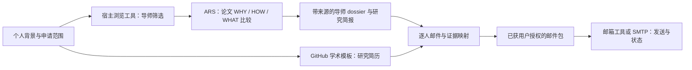

# Research Outreach · 科研套瓷 Skill

一个组合型 Codex skill：自动调研导师和近期论文，把研究方向与真实个人经历关联起来，制作研究简历和个性化进组邮件，并在授权范围内管理发送。

论文研究复用 [ARS-Codex](https://github.com/Imbad0202/academic-research-skills-codex) 的 `academic-research-suite`，PDF 检查优先复用已有 `pdf` skill，简历版式来自 [pmichaillat/latex-cv](https://github.com/pmichaillat/latex-cv)。本项目负责申请编排与产物交接，不再实现一套文献搜索、论文核验或通用 PDF 引擎。



## 安装与依赖

将本仓库作为 `research-outreach` 目录放在 Codex 的 skills 目录。默认位置为 `~/.codex/skills/research-outreach`；配置了 `CODEX_HOME` 时使用其下的 `skills/`。本仓库根目录就是 skill 目录。

```bash
git clone https://github.com/KunyangZhang/research-outreach-skill.git \
  "$HOME/.codex/skills/research-outreach"
```

论文自动研究阶段需要 `academic-research-suite`，本项目在 ARS 3.22.0 验证过入口与模式。安装复用 Codex 已有的 `skill-installer`：

```bash
python3 "$HOME/.codex/skills/.system/skill-installer/scripts/install-skill-from-github.py" \
  --repo Imbad0202/academic-research-skills-codex \
  --ref v3.22.0 --path skills/academic-research-suite
```

已有依赖无需重复安装。插件提供的依赖按其实际资源位置读取；本地可以检查：

```bash
python3 scripts/dependencies.py --mode research
```

可选 `pdf` skill 源于 [openai/skills](https://github.com/openai/skills/tree/main/skills/.curated/pdf)，缺失时使用宿主的 PDF 工具。安装后在下一轮或新会话中调用 `$research-outreach`。

## 使用

示例请求：

> 使用 $research-outreach。我是本科三年级学生，有一个 Python 数据分析项目，希望找华东地区计算材料方向的老师做暑期科研。先调研导师和近期论文，再根据我提供的真实经历准备简历和邮件，暂不发信。

> 使用 $research-outreach。这里是三位导师官网和我的简历。复用 ARS 比较他们近期论文的 WHY/HOW/WHAT，给出匹配理由和一个入门研究方案，然后各写一封邮件。

> 使用 $research-outreach。我已确认这三份邮件与附件，请按既定收件人名单逐封发送，并记录结果。

Skill 可以在没有邮箱配置时完成调研和材料。论文比较使用 ARS `three-way-scan`，研究主张核对使用 `fact-check`；不默认启动完整论文流水线。它不需要额外付费模型 API，网页搜索和判断由宿主 agent 与已有 skill 执行。

## 可执行辅助脚本

Python 3.10+，Linux/macOS；Python 脚本只使用标准库。简历编译另需 XeLaTeX 与对应 TeX 宏包。个人申请数据应放在仓库外的独立工作区。

```bash
mkdir -p /tmp/outreach-demo
cp assets/examples/* /tmp/outreach-demo/
python3 scripts/resume.py --workspace /tmp/outreach-demo --compile
python3 scripts/mail.py --workspace /tmp/outreach-demo draft
```

示例 `.invalid` 邮箱不会真实发送。`mail.py` 支持从 `teachers.csv` 读取个性化主题与完整正文；若未填写则使用基础中文模板。发送前记录当前邮件包的用户授权：

```bash
python3 scripts/mail.py --workspace /path/to/application approve MAIL_ID \
  --authorization-note '对应用户已经明确授权的说明'
python3 scripts/mail.py --workspace /path/to/application send-approved --interval 60
```

SMTP 参数通过当前进程环境变量提供：`SMTP_HOST`、`SMTP_USER`、`SMTP_PASSWORD`，可选 `SMTP_MODE` 和 `SMTP_PORT`。OAuth 邮箱使用实际可用的邮箱连接；此脚本不实现 OAuth。邮件修改后旧确认失效；不确定发送结果需核查，不能自动重发。完整规则见 [邮件参考](references/mail.md)。

## 产物与边界

工作区会包含导师候选表、来源记录、导师 dossier、论文研究简报、研究简历、邮件证据映射和发送状态。数据格式见 [data-contract.md](references/data-contract.md)，依赖调用见 [composition.md](references/composition.md)。

“自动研究”是公开资料检索、论文比较、来源核验及入门研究建议，不代表自动执行实验或发现新结果。邮件不会自动声称申请人读过论文或完成不存在的项目。回复监测与定时跟进仅在实际有邮箱/调度工具、且已获授权时启用；本仓库没有常驻后台服务。

## 验证

```bash
python3 -m unittest discover -s tests -v
```

测试使用临时工作区和模拟 SMTP，不发送真实邮件。中英文简历编译需本地 XeLaTeX；缺少时对应测试跳过。

## 许可证与来源

本包原创代码与说明为 MIT；简历样式保留上游 MIT 许可证和 commit 记录。ARS 是独立依赖，使用自己的 CC BY-NC 4.0 许可证，并未随本包复制分发；组合使用时应遵守各依赖的许可。来源与改动见 [THIRD_PARTY.md](THIRD_PARTY.md)。
